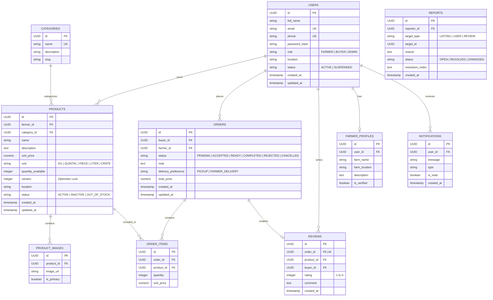

# Agricultural Marketplace: System Architecture & Technical Specification

## 1. System Overview
The **Agricultural Marketplace** is a robust three-tier web platform designed to directly connect local agricultural producers (farmers) with consumers, retailers, and restaurants. The platform eliminates intermediaries, stabilizes fair price discovery, provides real-time stock and order management, and establishes trust through reviews and transparent contact exchange upon order confirmation.

Target deployment: **Nekemte and surrounding agricultural communities**.

---

## 2. High-Level Architecture (3-Tier)

```mermaid
graph TD
    subgraph Client Tier [Presentation Tier - Next.js 14 App Router]
        FarmerUI[Farmer Dashboard & Management]
        BuyerUI[Marketplace Discovery & Orders]
        AdminUI[Admin Moderation & Analytics]
    end

    subgraph Service Tier [Application Tier - Spring Boot 3 REST API]
        AuthModule[Auth & JWT Security]
        ProductModule[Product & Category Engine]
        OrderModule[Order Lifecycle & Inventory Control]
        ReviewModule[Review & Rating Service]
        AdminModule[Moderation & Audit Service]
    end

    subgraph Data Tier [Persistence Tier]
        Postgres[(PostgreSQL 16 Database)]
        Storage[(Media Storage / Local Disk / S3)]
    end

    Client Tier -->|HTTPS / JSON REST API / Bearer JWT| Service Tier
    Service Tier -->|JPA / Hibernate / JDBC| Postgres
    Service Tier -->|Multipart Files| Storage
```

---

## 3. Domain Model & Entity Relationship (ERD)



---

## 4. Order Lifecycle State Machine

```mermaid
stateDiagram-v2
    [*] --> PENDING : Buyer places order (Validates stock)
    
    PENDING --> CANCELLED : Buyer cancels (Stock unreserved)
    PENDING --> REJECTED : Farmer rejects with reason
    PENDING --> ACCEPTED : Farmer accepts (Stock deducted; Contact details revealed)

    ACCEPTED --> READY : Farmer marks ready for delivery/pickup
    READY --> COMPLETED : Order fulfilled (Buyer enabled to write 1 review)
    ACCEPTED --> CANCELLED : Mutual / Admin cancellation (Stock restored)
    
    COMPLETED --> [*]
    REJECTED --> [*]
    CANCELLED --> [*]
```



---

## 5. Concurrency & Overselling Prevention
To satisfy **FR-5.4** and **NFR-3**:
1. **Optimistic Locking**: Product entities carry a `@Version` field. Concurrent checkout updates detect version conflicts and handle rollback gracefully.
2. **Transactional Deductions**: Deductions execute inside `@Transactional(isolation = Isolation.READ_COMMITTED)` blocks with atomic quantity checks (`quantity_available >= requested_quantity`).
3. **Automatic Status Transitions**: When `quantity_available` reaches 0, the product automatically transitions to `OUT_OF_STOCK`.

---

## 6. Role-Based Access Control (RBAC) Matrix

| Endpoint Group | Method | Description | Roles Permitted |
|---|---|---|---|
| `/api/auth/**` | POST | Register, Login, Token Refresh | Public |
| `/api/products` (list) | GET | Browse & Search listings | Public |
| `/api/products/{id}` | GET | View product details | Public |
| `/api/products` (create) | POST | Create new listing | `ROLE_FARMER` |
| `/api/products/{id}` | PUT/DELETE | Modify or deactivate listing | `ROLE_FARMER` (Owner), `ROLE_ADMIN` |
| `/api/orders` | POST | Place new order | `ROLE_BUYER` |
| `/api/orders/{id}/cancel` | PATCH | Cancel pending order | `ROLE_BUYER` (Owner), `ROLE_ADMIN` |
| `/api/orders/{id}/status` | PATCH | Accept, Ready, Complete, Reject | `ROLE_FARMER` (Seller), `ROLE_ADMIN` |
| `/api/reviews` | POST | Leave review on completed order | `ROLE_BUYER` (Verified customer) |
| `/api/admin/**` | GET/POST/PATCH | User moderation, reports, categories | `ROLE_ADMIN` |
